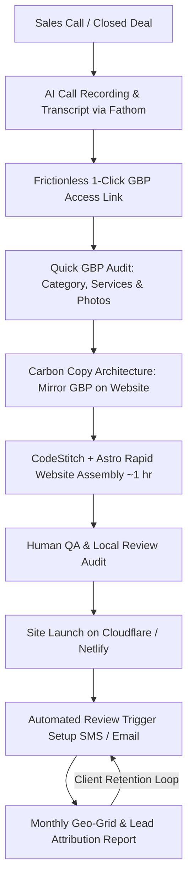
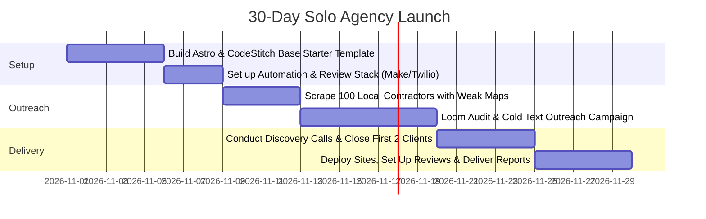

# Blueprint: Building a $12k/Month Agency Selling Websites & GBP Management to Contractors

> **Based on the Breakdown & Case Study by Sam Robinson**  
> **Source Video:** [I make 12k/month Selling Websites to Contractors. Here's how. (YouTube: HBvqrZmfEQc)](https://youtu.be/HBvqrZmfEQc)  
> **Target Audience:** Solo agency founders, freelance web developers, local SEO consultants, and B2B SaaS builders.

---

## Table of Contents
1. [Executive Summary & Core Philosophy](#1-executive-summary--core-philosophy)
2. [Financial Architecture & Unit Economics](#2-financial-architecture--unit-economics)
3. [The Productized Offer & Pricing Tiers](#3-the-productized-offer--pricing-tiers)
4. [Step-by-Step Operational Workflow](#4-step-by-step-operational-workflow)
   - [Phase 1: Frictionless Onboarding & Access](#phase-1-frictionless-onboarding--access)
   - [Phase 2: The High-Impact GBP Audit](#phase-2-the-high-impact-gbp-audit)
   - [Phase 3: The "Carbon Copy" Architecture (GBP ↔ Website)](#phase-3-the-carbon-copy-architecture-gbp--website)
   - [Phase 4: The Automated Review Generation Engine](#phase-4-the-automated-review-generation-engine)
   - [Phase 5: The 1-Hour Static Site Assembly Pipeline](#phase-5-the-1-hour-static-site-assembly-pipeline)
   - [Phase 6: The Retention Engine (The Monthly Report)](#phase-6-the-retention-engine-the-monthly-report)
5. [The Technology Stack & Tooling Costs](#5-the-technology-stack--tooling-costs)
6. [Sales Calls, No-Shows & Client Management](#6-sales-calls-no-shows--client-management)
7. [Standard Operating Procedures (SOPs) & Checklists](#7-standard-operating-procedures-sops--checklists)
8. [Risks, Pitfalls & Mitigation Strategies](#8-risks-pitfalls--mitigation-strategies)
9. [30-Day Implementation Roadmap](#9-30-day-implementation-roadmap)

---

## 1. Executive Summary & Core Philosophy

### The Flaw in Traditional Web Design Agencies
The traditional web design model is broken:
- Freelancers spend weeks designing custom sites on WordPress, Webflow, or Wix.
- They charge a one-time fee ($1,500 – $3,500).
- After launch, the client relationship terminates, forcing the freelancer to restart client acquisition from scratch every single month.
- WordPress sites suffer from plugin vulnerabilities, slow page speeds, and hosting breakages that lead to unpaid troubleshooting.

### The Contractor Mindset
Local blue-collar contractors (roofers, plumbers, remodelers, electricians, tree trimmers) do not care about:
- Parallax scrolling, dynamic animations, or trendy design aesthetics.
- Technical tech-stack debates.

**Contractors care about one thing:**  
**Does the phone ring with high-intent local homeowners wanting quotes?**

### The Solution: The Retainer Model
Package ultra-fast, high-converting static websites with **Google Business Profile (GBP) optimization and automated review systems** into a mandatory recurring monthly subscription ($197/mo – $450/mo). 

By solving customer acquisition and local reputation rather than "selling a website", the agency shifts from a transactional vendor to a mission-critical utility.

---

## 2. Financial Architecture & Unit Economics

### Monthly Recurring Revenue (MRR) Breakdown
To reach **$12,000/month**, a solo operator does not need hundreds of clients. A healthy distribution across the two core packages looks like:

```
┌─────────────────────────────────────────────────────────────┐
│ 15 Clients on Tier 1 ($197/mo)          =  $2,955 / month   │
│ 20 Clients on Tier 2 ($450/mo)          =  $9,000 / month   │
│ Total Monthly Recurring Revenue (MRR)   = $11,955 / month   │
│ Annual Run Rate (ARR)                   = $143,460 / year   │
└─────────────────────────────────────────────────────────────┘
```

### Profit Margins & Overhead
Because the tech stack utilizes modern static hosting and automated APIs, variable marginal costs per client are near zero:

- **Hosting & CDN (Cloudflare Pages / Netlify):** $0 – $20/month total across all sites.
- **Form Handling / Static APIs:** $0 – $15/month.
- **Review Automation & SMS Costs:** ~$5 – $10/client/month.
- **Reporting & Geo-Grid Rank Tracking:** ~$1 – $2/client/month.
- **Total Overhead:** ~$300 – $500/month.
- **Net Profit Margin:** **> 92% – 95%**.

---

## 3. The Productized Offer & Pricing Tiers

Sam Robinson standardizes his client contracts into two crystal-clear packages:

```
                            THE SERVICE PACKAGES
       ┌──────────────────────────────┬──────────────────────────────┐
       │     Starter Retainer         │       Growth Retainer        │
       │        $197 / Month          │         $450 / Month         │
       ├──────────────────────────────┼──────────────────────────────┤
       │ • Custom Ultra-Fast Website  │ • Custom Ultra-Fast Website  │
       │ • Ultra-Fast Static Hosting  │ • Ultra-Fast Static Hosting  │
       │ • SSL, Backups & Domain Mgt  │ • SSL, Backups & Domain Mgt  │
       │ • Automated Review Engine    │ • Automated Review Engine    │
       │ • Unlimited Content Edits    │ • Full GBP Active Management │
       │                              │ • Monthly Geo-Grid Tracking  │
       │                              │ • Social Media Syndication   │
       │                              │ • Detailed Monthly ROI Report│
       └──────────────────────────────┴──────────────────────────────┘
```

### Package 1: The Starter Retainer ($197 / month)
- **Target:** Newer or budget-sensitive contractors whose current website is either nonexistent, broken on mobile, or built on outdated platforms.
- **Deliverables:**
  - High-performance, mobile-responsive static website (100/100 Google PageSpeed).
  - High-speed hosting and ongoing maintenance.
  - SMS & email automated review collection system.
  - Basic local contact forms routing leads directly to the contractor’s mobile phone.

### Package 2: The Growth & Dominance Retainer ($450 / month)
- **Target:** Established contractors actively competing for high-ticket residential or commercial jobs in their metro area.
- **Deliverables:**
  - Everything in the $197/month tier.
  - Complete Google Business Profile setup, weekly posting, and ongoing optimization.
  - Local citation consistency auditing.
  - Monthly geo-grid rank tracker heatmaps showing exact positioning across local neighborhoods.
  - Call, form, and direction request attribution reports proving measurable ROI.

---

## 4. Step-by-Step Operational Workflow



---

### Phase 1: Frictionless Onboarding & Access
- **Problem:** Contractors hate technical friction. Asking for passwords or navigating complex Google Business settings causes onboarding drop-off.
- **Process:**
  1. Immediately after closing, text the contractor a single access link (using Google Account Manager access delegation or merchant onboarding software).
  2. The contractor opens the text on their phone, taps "Approve", and managerial access is granted in seconds without sharing passwords.

---

### Phase 2: The High-Impact GBP Audit
Before generating website code, audit and optimize the contractor's Google Maps profile:
1. **Primary Category Optimization:** Ensure the primary category represents their single most profitable service (e.g., *"Roofing Contractor"* instead of generic *"General Contractor"*).
2. **Secondary Categories:** Add up to 4–6 secondary categories covering adjacent services (e.g., *"Siding Contractor"*, *"Gutter Cleaning Service"*).
3. **Services Matrix:** Populate the services section with granular descriptions containing natural local keywords.
4. **Authentic Photography:** Discourage stock imagery. Request real smartphone photos of work trucks, crew on job sites, and completed projects. Google’s Vision AI recognizes real job site metadata.

---

### Phase 3: The "Carbon Copy" Architecture (GBP ↔ Website)
Google’s ranking algorithm values consistency between the Google Business Profile and the associated website landing page.

* **NAP Consistency:** Name, Address, and Phone number must be identical to the letter.
* **Service Symmetry:** Every service item listed in the GBP should have an exact corresponding landing page or section on the website with an matching `<h1>` tag:
  - GBP Service: *Kitchen Remodeling* ➔ Website Page: `/kitchen-remodeling` (`<h1>Kitchen Remodeling in [City, State]</h1>`)
  - GBP Service: *Bathroom Renovations* ➔ Website Page: `/bathroom-renovations` (`<h1>Bathroom Renovations in [City, State]</h1>`)
* **Local Entity Embedding:** Embed the Google Maps location directly in the footer and contact pages.

---

### Phase 4: The Automated Review Generation Engine
Reviews are the lifeblood of local ranking algorithms and homeowner trust.

#### The Frictionless Input Flow
Contractors will not log into complicated software dashboards at the end of an exhausting workday.
1. When a job is completed, the contractor simply **texts the client’s name and phone number** (or snaps a picture of their physical paper invoice) to a dedicated agency number.
2. An automated workflow (Zapier / Make / Webhook) receives the message, extracts the contact data, and triggers a delayed SMS sequence:
   > *"Hi [Customer], thank you for choosing [Business Name]! If you were happy with our work, could you take 30 seconds to share your experience on Google? It helps our local team immensely: [Direct Google Review Shortlink]"*
3. If no review is detected after 48 hours, a single friendly follow-up is dispatched.

---

### Phase 5: The 1-Hour Static Site Assembly Pipeline

#### Tech Stack Selection
- **Framework:** [Astro](https://astro.build/) — Zero-JavaScript by default, generating purely static HTML/CSS that loads instantly.
- **Component Library:** [CodeStitch](https://codestitch.app/) — Production-ready, responsive, accessible HTML/CSS components designed specifically for local service businesses.
- **Hosting:** Cloudflare Pages or Netlify (instant deployment, automated SSL, global edge CDN).

#### The 60-Minute Build SOP
1. **Minute 0 – 10 (AI Ingestion):**
   - The onboarding/sales call is automatically transcribed by **Fathom AI**.
   - The transcript is processed by an LLM (Claude 3.5 Sonnet or ChatGPT) using a structured prompt:
     - Extracts: Unique selling propositions, owner bio, service radius, warranty info, top 3 services.
     - Generates: High-converting, SEO-optimized copy matching the GBP service headings.
2. **Minute 10 – 35 (Component Stacking):**
   - Open a pre-configured Astro starter template.
   - Assemble CodeStitch modular sections:
     - Hero with explicit Call to Action (CTA) & Click-to-Call button.
     - Trust badges (BBB, insured, licensed, Google rating).
     - Dedicated Services Grid mirroring GBP.
     - Real Project Gallery.
     - Customer Testimonials section.
     - Localized Contact Form & Google Map Embed.
3. **Minute 35 – 50 (Content & Asset Insertion):**
   - Inject the AI-generated localized copy.
   - Compress and convert job-site photos into modern WebP format.
   - Insert contractor phone number formatted as clickable `tel:+1...` links.
4. **Minute 50 – 60 (Quality Assurance & Launch):**
   - **Crucial Step:** Read through the copy manually. Ensure the AI did not hallucinate certifications, state licenses, or warranty guarantees not offered by the contractor.
   - Deploy to production. Verify a **95–100 score on Google PageSpeed Insights**.

---

### Phase 6: The Retention Engine (The Monthly Report)

Contractors cancel services when they don't see tangible value. The monthly report is the protective moat that maintains sub-3% churn across the agency.

```
┌─────────────────────────────────────────────────────────────┐
│                 MONTHLY CONTRACTOR ROI REPORT               │
├─────────────────────────────────────────────────────────────┤
│ 1. Local Geo-Grid Heatmap:                                  │
│    Visual 5x5 or 7x7 grid showing rank #1 - #3 across all    │
│    surrounding zip codes on Google Maps.                    │
│                                                             │
│ 2. Real Lead Volume:                                        │
│    • Phone calls originated from Google Maps                │
│    • Click-to-call taps from mobile website                 │
│    • Direction requests & contact form submissions          │
│                                                             │
│ 3. Review Growth:                                           │
│    • Total reviews added this month                         │
│    • Current average star rating vs top 3 competitors       │
│                                                             │
│ 4. AI Search & SGE Visibility:                              │
│    • Overview of citations inside AI search overviews       │
└─────────────────────────────────────────────────────────────┘
```

When a contractor sees a green heatmap showing their business ranked #1 across their city, cancelling the $450/month fee feels like turning off their own phone line.

---

## 5. The Technology Stack & Tooling Costs

| Tool | Category | Purpose | Approximate Monthly Cost |
| :--- | :--- | :--- | :--- |
| **Astro** | Web Framework | Static site generator for 100/100 PageSpeed | Free / Open Source |
| **CodeStitch** | Component Library | Pre-coded, accessible HTML/CSS UI blocks | $29 / month |
| **Cloudflare Pages / Netlify**| Hosting & Edge CDN | Zero-maintenance static hosting with global SSL | Free – $20 / month |
| **Fathom AI** | Call Assistant | Records and transcribes client discovery calls | $19 – $29 / month |
| **Claude / ChatGPT** | LLM Engine | Converts call transcripts into localized copy | $20 / month |
| **Local Falcon / Places Scout**| Geo-Grid Tracker | Generates monthly Google Maps rank heatmaps | $25 – $50 / month |
| **Twilio / Make / Zapier** | Automation & SMS | Dispatches automated SMS review requests | $10 – $30 / month |
| **Total Agency Overhead** | — | — | **~$100 – $170 / month** |

---

## 6. Sales Calls, No-Shows & Client Management

### Handling No-Shows & Contractor Flakiness
Contractors are frequently in the field, on roofs, or dealing with emergencies. Missed calls are common.
- **Automated SMS Reminders:** Send SMS reminders 2 hours and 15 minutes prior to the scheduled call.
- **Asynchronous Audit (The Loom Pivot):** If a contractor fails to show up:
  - Do not send angry follow-ups.
  - Record a 3-minute personalized Loom screen recording auditing their current Google Business Profile, comparing it to their top competitor, and highlighting 3 immediate fixes.
  - Text the video link directly: *"Hey [Name], missed you on our call! Recorded this 3-min video breaking down why [Competitor] is outranking you in Google Maps and how you can fix it. Take a look when you’re off the job site."*

### The Sales Pitch: Selling Revenue, Not Code
When speaking to contractors, use their language:
- **Do not say:** *"We write clean semantic HTML with Astro to optimize Core Web Vitals."*
- **Do say:** *"When a homeowner’s roof starts leaking during a storm, they search on Google Maps on their phone. We make sure your business is the first one they see and that your site loads in under a second so they call you before calling your competitor."*

---

## 7. Standard Operating Procedures (SOPs) & Checklists

### Quick Launch Checklist (Pre-Flight)
- [ ] Primary GBP category matches main revenue driver.
- [ ] Secondary GBP categories populated (4–6 relevant categories).
- [ ] Exact NAP match between GBP footer and website contact info.
- [ ] All phone links configured with `href="tel:+1XXXXXXXXXX"`.
- [ ] Contact forms test-submitted; email and SMS alerts confirmed.
- [ ] Google Maps direct review shortlink tested on mobile.
- [ ] Favicon, OpenGraph meta tags, and localized page titles set.
- [ ] Google PageSpeed score confirmed above 90+ on mobile.
- [ ] Human QA performed: No generic placeholder text or hallucinated licenses.

---

## 8. Risks, Pitfalls & Mitigation Strategies

### Risk 1: Google Business Profile Suspensions
- **Cause:** Changing core information (Business name, address, or phone) abruptly can trigger automated Google re-verification or suspensions.
- **Mitigation:** Never modify the business name to stuff keywords if it doesn't match their legal business registration. Update categories and services incrementally.

### Risk 2: Client Blaming the Agency for Slow Seasons
- **Cause:** In winter or slow construction cycles, inbound calls naturally drop.
- **Mitigation:** Rely on the monthly geo-grid report. If the contractor maintains the #1 rank on maps, prove that their visibility remained dominant despite seasonal market search-volume declines.

### Risk 3: Burnout from One-Off Edit Requests
- **Cause:** Clients demanding endless minor photo and text changes.
- **Mitigation:** Set clear SLA boundaries in the agreement: edits are submitted via a simple form or email and processed within 48 business hours.

---

## 9. 30-Day Implementation Roadmap



### Week 1: Infrastructure
- Clone a high-speed Astro starter project.
- Connect your CodeStitch library account.
- Configure SMS automation templates for review requests.

### Week 2: Prospecting
- Open Google Maps in your target county or metro area.
- Identify 50–100 contractors ranking in positions #4 through #15 with 10+ reviews but outdated websites.
- Record short 2-minute video audits pointing out missing GBP services and mobile speed bottlenecks.

### Week 3: Sales & Closing
- Conduct 15-minute diagnostic discovery calls.
- Pitch the $197/mo or $450/mo package. Collect payment upfront via Stripe subscription.
- Send the 1-click Google access link.

### Week 4: Delivery & Onboarding
- Run the call transcript through AI, assemble the site using CodeStitch, QA, and launch within 48 hours.
- Initiate the review automation pipeline.
- Schedule the first 30-day Geo-Grid report to lock in client retention.

---

*Document compiled and structured for immediate operational implementation.*
